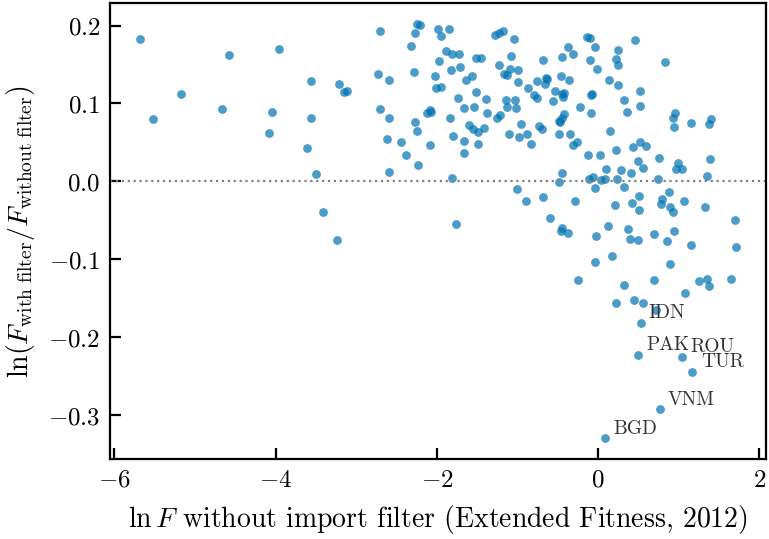
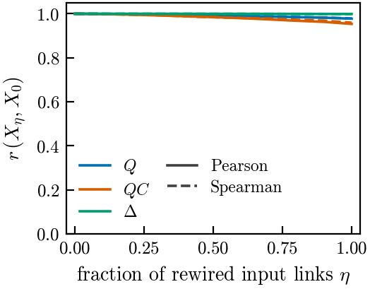
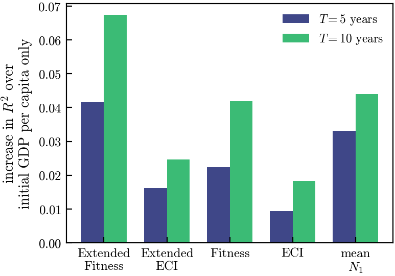

# Economic complexity with production networks and import dependencies

Extensions of the two standard economic complexity algorithms, the **Economic Complexity Index
(ECI)** and **Fitness–Complexity**, that use the **production network** between products and correct
countries' scores for the complexity of the **inputs they import**.

*Master's thesis, MSc in Physics of Complex Systems, University of Turin, carried out at the
[Complexity Science Hub](https://csh.ac.at) Vienna (2026). Supervisor: Prof. Marco Pangallo;
co-supervisors: Dr. Vito D. P. Servedio and Dr. Leonardo Ialongo (CSH).*



*Extended Fitness of each country with and without the import filter (2012, HS4). Although the
filter is built only to remove the complexity of imported inputs, the countries it penalises most
are assembly economies (Bangladesh, Vietnam, Turkey, Pakistan, Indonesia, …), not simply the countries
most integrated in global value chains.*

## The idea

Classical complexity metrics are computed only from the bipartite network of which country exports
which product. This has two blind spots:

- **supply-chain blindness**: the complexity of a product is inferred only from who exports it,
  with no information on what it is made of;
- **assembly trap**: a country gets full credit for exporting a complex product even when its
  complex components are imported.

The extended algorithm keeps the country–product recursion and adds two blocks:

$$
\begin{aligned}
\bar{F}^{(n+1)} &= \phi_X\big(Q^{(n)}\big) - S^{(n)} && \text{country score, minus imported input complexity}\\
\bar{\Delta}^{(n)} &= \Theta_X\big(F^{(n)}\big) && \text{intrinsic complexity (as in ECI / Fitness)}\\
\bar{Q}^{(n+1)} &= Q^{(n)} \, \alpha C + \Delta^{(n)} && \text{product complexity = intrinsic + inherited from inputs}
\end{aligned}
$$

with each vector normalised by its mean at every step. $C_{p'p} = 1$ if product $p'$ is an input of
$p$ (from the AI-generated production network **AIPnet**, Fetzer et al. 2024), $\phi_X, \Theta_X$
are the maps of the classical ECI or Fitness algorithm, and $S$ subtracts the complexity of the
inputs that a country imports (built from the binary import matrix $M^I$). With $\alpha = 0$ and
$S = 0$ the classical algorithms are recovered exactly.

## Main results

- **Theory.** At the fixed point the product complexity is a *personalised Katz centrality* of the
  production network: each product accumulates the intrinsic complexity of all the supply chains
  that flow into it, damped at every step upstream. The dimensionless parameter $a = \alpha\,\rho(C)$
  makes the propagation strength comparable across networks; with $a = 1$ intrinsic and input
  complexity have comparable weight.
- **Numerics.** Extended Fitness converges in a few tens of iterations and keeps scores away from
  zero, unlike classical Fitness. The import penalty is evaluated with a Horner scheme, so the powers
  of $C$ are never built.
- **Growth regressions.** Among the metrics tested one at a time, Extended Fitness adds the most
  explanatory power to GDP per capita growth over 5 and 10 years. These are in-sample associations
  with wide uncertainty, not a proof of better forecasting.
- **A critical result: the number of inputs.** A null model that rewires the inputs of every
  product, keeping their number fixed, leaves the ranking of product complexity almost unchanged.
  Most of the network signal therefore comes from *how many* inputs a product has rather than
  *which* ones. This is not just an artefact (the mean number of inputs alone predicts growth
  almost as well), but it means that the current specification uses the supply-chain structure
  only in part. The thesis discusses which block of the algorithm to change to address it.

<p align="center">
  
  
</p>

*Left: correlation (Pearson, solid; Spearman, dashed) between the scores on the original network
and on a network where a fraction η of the input links is rewired, preserving the number of inputs
of each product: product complexity Q, input complexity QC, intrinsic complexity Δ (HS4).
Right: increase in R² of growth regressions over a model with only initial GDP per capita, when
one complexity metric is added (mean N₁ = average number of inputs of the exported products).*

## Repository structure

```
├── src/
│   ├── algorithms.py              ECI, Fitness and their extensions without the import filter
│   ├── algorithms_with_imports.py Extended ECI / Extended Fitness with the import filter (core of the thesis)
│   ├── preprocessing.py           from BACI trade flows and AIPnet to the binary matrices M^E, M^I, C
│   ├── C_properties.py            spectral radius, nilpotency and mean in-degree of the production network
│   ├── matrix_perturbations.py    null models: rewiring of C, perturbation of the country-product matrices
│   ├── C_alberizzazione.py        removal of feedback arcs (acyclic, nilpotent C)
│   ├── econometrics.py            OLS with clustered standard errors for the growth regressions
│   ├── storage.py, plotting.py    I/O of results, common plotting style
│   └── analysis.py, mixed_functions.py   accessory / experimental helpers
├── notebooks/
│   ├── data_generation/           run the algorithms and save results (stability, convergence, metrics by year)
│   ├── plotting/                  thesis figures from the saved results
│   ├── econometria/               growth regressions, external validation, effect of the import filter
│   └── archive/                   early exploration, kept for reference
├── scripts/readme_figures.py      figures of this README
└── docs/figures/
```

The core algorithms are in `src/`; notebooks are research logs, with comments in Italian.

## Data

The data are not included because of their size and licences. The pipeline uses:

- **BACI** (CEPII) bilateral trade flows, HS 2002 classification, 2002–2024, at 4 and 6 digits;
- **AIPnet** product-level production network (Fetzer, Lambert, Feld and Garg, 2024);
- **Penn World Table 11.0** for GDP per capita, plus OECD TiVA, World Bank and UNDP indicators for
  the external validation.

`src/preprocessing.py` turns the raw files into the binary matrices expected by the algorithms,
stored under `data/HS02_all_years/{4,6}_digits/alligned/binarized/`.

## Usage

```bash
pip install -r requirements.txt
```

```python
from src.algorithms import compute_alpha
from src.algorithms_with_imports import compute_extended_fitness_with_imports

# M_export, M_import: binary country x product DataFrames (RCA >= 1)
# C: binary product x product DataFrame, C[p', p] = 1 if p' is an input of p
alpha = compute_alpha(C)          # alpha = 1 / rho(C), i.e. a = 1
Q, F, QC, Delta, S = compute_extended_fitness_with_imports(
    M_export, M_import, C.T, alpha=alpha, tensor_window=3, tol=1e-6, track_convergence=False)
```

`Q` is the product complexity (with its input part `QC` and intrinsic part `Delta`), `F` the
country fitness and `S` the import penalty.

## Author

Vittorio Bargero, MSc in Physics of Complex Systems, University of Turin.
